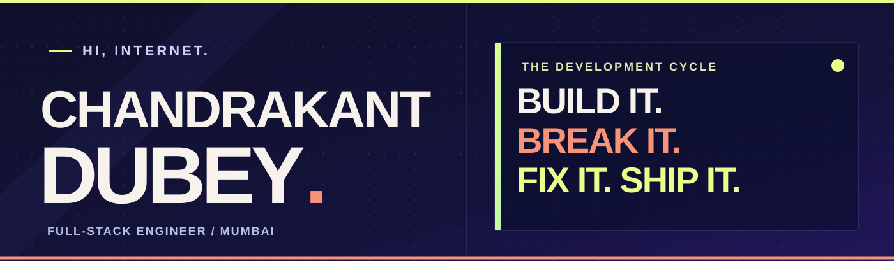

  

  
<strong>Full-stack engineering · Backend systems · Cloud · Applied AI</strong>

  

    <a href="https://chandrakantdubey.vercel.app/">The interactive portfolio</a> &nbsp;·&nbsp;
    <a href="https://www.linkedin.com/in/chandra-kant-dubey/">LinkedIn</a> &nbsp;·&nbsp;
    <a href="https://chandrakantdubey.vercel.app/Chandrakant_Dubey.pdf">Résumé</a> &nbsp;·&nbsp;
    <a href="mailto:919chandrakant@gmail.com">Email</a>
  

I build products end to end: the interfaces people see, the APIs they blame, and the infrastructure quietly keeping everything alive. Based in **Mumbai, India**; currently a **Full Stack Engineer at Adeptken**.

My comfort zone is **React / TypeScript, Python / FastAPI, Node.js, databases, cloud delivery, and the awkward space between “it works” and “it works in production.”** Lately I’m also building with LLMs and ML-backed systems—where latency and cost still have the final say.

## Code that escaped localhost

| What I built | Why it exists | Under the hood |
| :--- | :--- | :--- |
| **[Blackout Protocol](https://github.com/chandrakantdubey/blackout-protocol)** | Cooperative city-grid repair game. Six roles, shared live maps, and teamwork that sometimes even works. | Next.js · TypeScript · Colyseus · WebSockets |
| **[Timesheet](https://github.com/chandrakantdubey/timesheet)** · *Prototype* | Timesheets, leave, attendance, and a browser extension. Apparently paperwork needed microservices. | React · Node.js · Oracle · Chrome MV3 |
| **[StyleScape](https://github.com/chandrakantdubey/style-scape)** | A procedural SVG design studio with seeded patterns and CSS/SVG/PNG export. One gradient was not enough. [Try it](https://style-scape-flax.vercel.app/). | React · TypeScript · Zustand · SVG |
| **[Pokédex RPG](https://github.com/chandrakantdubey/pokedex-backend)** | FastAPI game backend for a [React Native / Expo client](https://github.com/chandrakantdubey/pokedex). Because even imaginary creatures deserve persistent state. | FastAPI · React Native · PostgreSQL · SQLAlchemy |
| **[FitStream](https://github.com/chandrakantdubey/fitstream)** | Fitness PWA with workouts, GPS routes, and progress tracking. Push-ups remain stubbornly non-automatable. | React · FastAPI · Leaflet · SQLite |
| **[FarmPulse](https://github.com/chandrakantdubey/farmpulse)** · *In development* | Sensor-analytics prototype using synthetic farm data. The telemetry is real; the crops are not. | Next.js · FastAPI · TimescaleDB · Docker |

Other rabbit holes include a [local-first notebook](https://github.com/chandrakantdubey/mh15). The rest are in [the repositories tab](https://github.com/chandrakantdubey?tab=repositories), where side projects occasionally outnumber sensible decisions.

## Yes, I have shipped things with other humans

| Where | When | What I worked on |
| :--- | :--- | :--- |
| **Adeptken** · Full Stack Engineer | Jan 2026 – present | Enterprise workflows, backend services, and cloud infrastructure. |
| **Nutriiya** · Full Stack Engineer (contract) | Sep 2025 – Jan 2026 | Product interfaces, caching, and backend features for nutrition software. |
| **Kintree** · Full Stack Developer | Nov 2024 – Jan 2026 | Collaborative family-graph interfaces, real-time features, and APIs. |
| **Uvation** · Software Engineer (Frontend) | Aug 2023 – Oct 2024 | Commerce experiences and customer-facing frontend systems. |

Some of that team work is public: [Uvation Marketplace](https://marketplace.uvation.com), [Uvation Rewards](https://rewards.uvation.com), [Kintree](https://kintree.com), [Bombay Dyeing Retail](https://retail.bombaydyeing.com/), [Brush of Hope](https://brushofhope.life), and [Nutriiya](https://nutriiya.com). These are **team contributions**, not personal open-source repositories.

Other projects live inside bank intranets: **i-Compass** (performance reviews), **VAMS** (vendor timesheets), and internal **learning & development** and **CSR** portals. No public demos; security teams tend to appreciate that.

## My usual suspects

| | Things I reach for |
| :--- | :--- |
| **Web** | React, TypeScript, Next.js, React Native, Tailwind CSS |
| **Services** | Python, FastAPI, Node.js, Express, REST APIs, SQLAlchemy |
| **Data** | PostgreSQL, Oracle, Redis, SQLite, MongoDB |
| **Infrastructure** | AWS, Docker, Kubernetes, Terraform, GitHub Actions, Linux |
| **Systems & AI** | Distributed systems, caching, observability, LLM applications, ML pipelines |

## Have a problem worth overengineering?

I prefer the boring kind of reliability and the interesting kind of product. If you are building something ambitious, [say hello](mailto:919chandrakant@gmail.com) or [explore the portfolio](https://chandrakantdubey.vercel.app/)—which includes playable games because apparently I cannot leave well enough alone.

Built with curiosity, maintained with tests, occasionally repaired with coffee.

